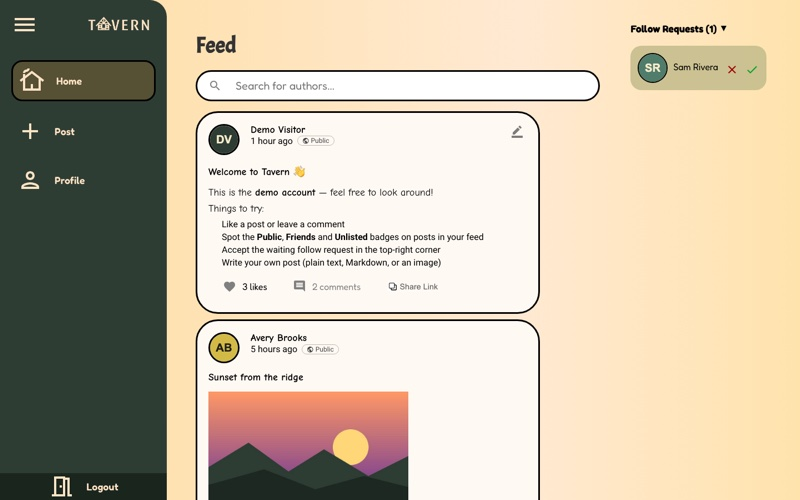
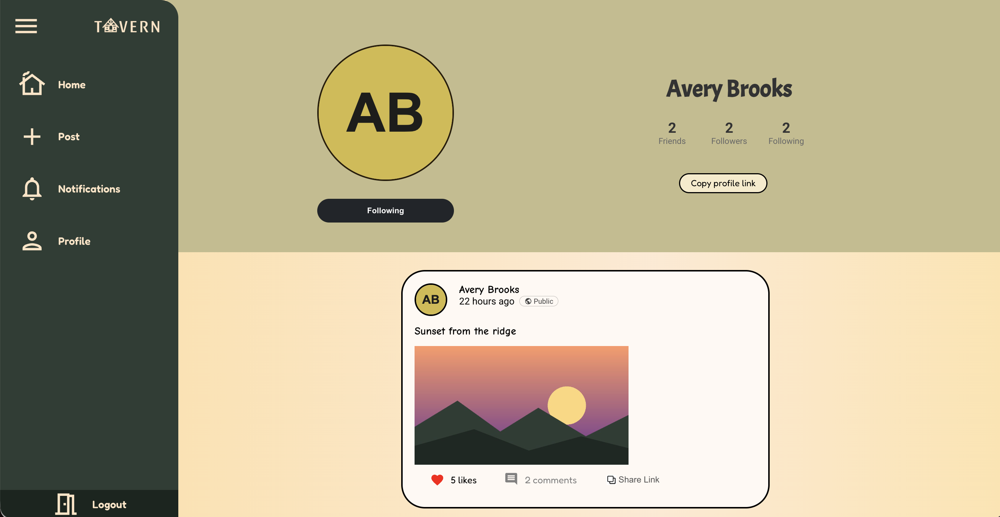
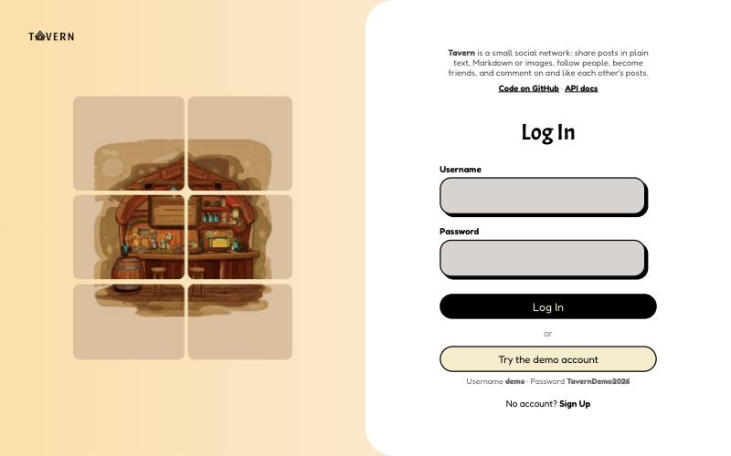
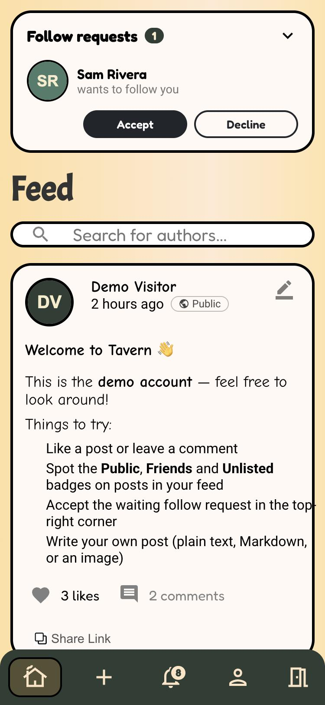

# Tavern

**Live demo: [tavern-weyv.onrender.com](https://tavern-weyv.onrender.com)**: click **Try the demo account** on the login page.

A social networking web app where authors can post (plain text, Markdown, or images), follow each other, become friends, and comment on and like posts. Built with Django REST Framework and React.

Originally built as a team project for CMPUT 404 at the University of Alberta.

## Features

- Sign up, log in, and edit your profile (display name, GitHub link, profile picture)
- Create, edit, and delete posts with public, unlisted, or friends-only visibility
- One timeline with infinite scroll on the home feed and profiles, with a visibility badge on each post
- Follow requests, followers, and friends (mutual follows)
- Comments and likes on posts and comments; delete your own comments and any comment on your posts
- Notifications for likes, comments, and follows, with an unread badge
- Pull your public GitHub activity into your feed
- Phone-friendly layout
- Django admin panel for managing users and content
- Interactive API docs at [`/swagger/`](https://tavern-weyv.onrender.com/swagger/)

## Try it

Open the [live site](https://tavern-weyv.onrender.com) and use **Try the demo account** on the login page (username `demo`, password `TavernDemo2026`).
The demo account is friends with a few sample people, has a follow request and unread notifications
waiting, and its feed includes public, friends-only and unlisted posts with comments and likes. Its
profile can't be edited since everyone shares it; sign up to get your own account. Anything a visitor changes as
the demo account is undone automatically the next time someone logs in as the demo (at most every
10 minutes), so everyone starts from the same clean demo.

## Screenshots

| Home feed | Profile |
|---|---|
|  |  |

| Login with one-click demo | On a phone |
|---|---|
|  |  |

## Tech stack

- **Backend:** Django 5.2, Django REST Framework, Simple JWT, WhiteNoise, Gunicorn
- **Frontend:** React 18, React Router, Material UI
- **Database:** PostgreSQL in production, SQLite locally

## Running locally

```bash
python3 -m venv .venv
source .venv/bin/activate
pip install -r requirements.txt

cd frontend
npm install
npm run build
cd ..

cd mistyrose
export DJANGO_DEBUG=True
python manage.py migrate
python manage.py createsuperuser
python manage.py seed_demo --site-url http://127.0.0.1:8000   # optional demo account + sample posts
python manage.py runserver
```

Then open http://127.0.0.1:8000. The admin panel is at `/admin/`.

Run the backend tests with `python manage.py test` from `mistyrose/`.

## Deploying

The live site runs on Render's free plan with a Neon Postgres database. Render puts free services to sleep after about 15 minutes without traffic, so an [UptimeRobot](https://uptimerobot.com) monitor requests the homepage every 5 minutes to keep the site awake and send an email if it goes down. The repo includes a `render.yaml` blueprint and a `build.sh` script. See `.env.example` for every environment variable the app reads. At minimum, production needs `DJANGO_SECRET_KEY` and a `DATABASE_URL` pointing at a hosted Postgres database.

## Team

Syjer Asuncion, Rithwik Korukonda Bhattar, Franco Bonilla, Xiangxu Meng, Kelly Shih, Sapandeep Singh

## License

MIT
