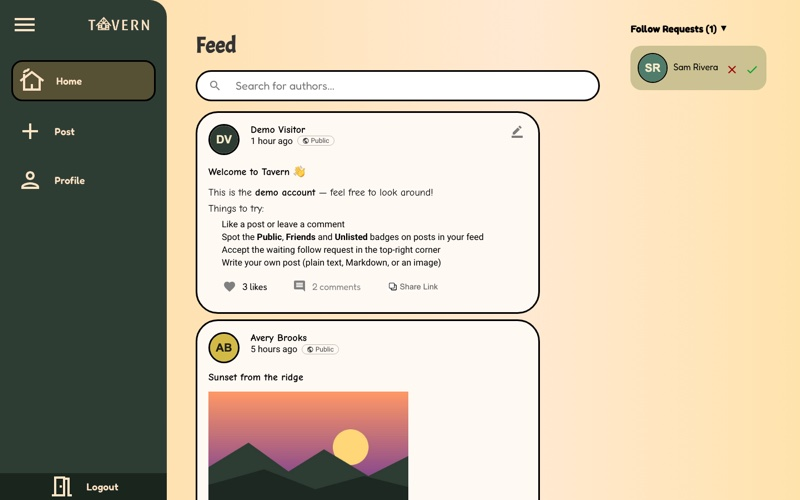
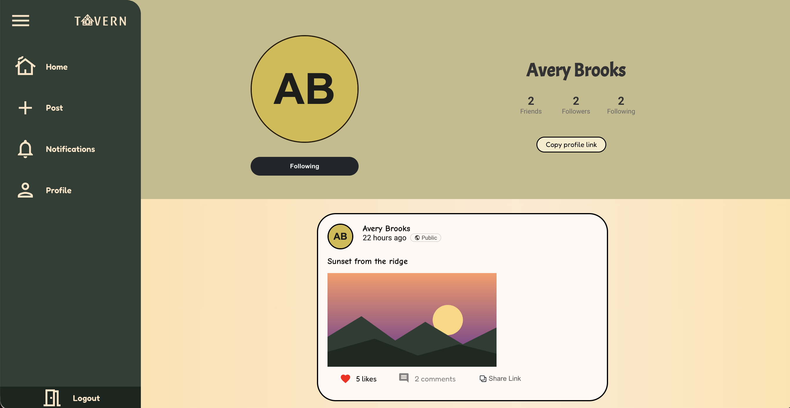
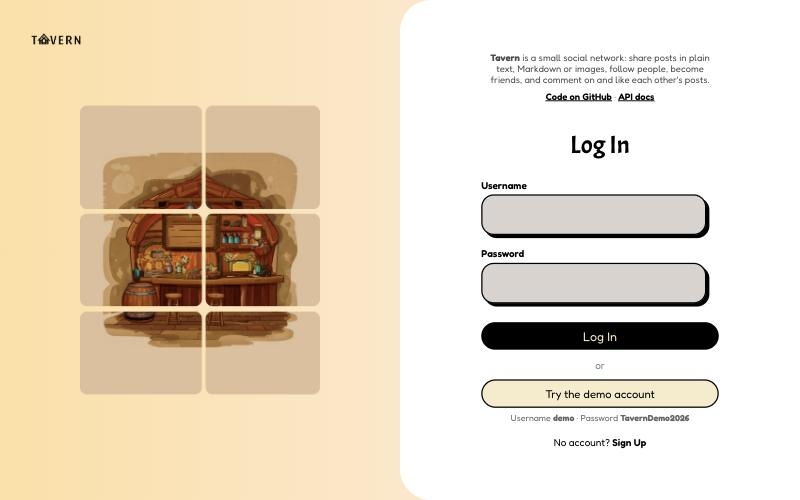
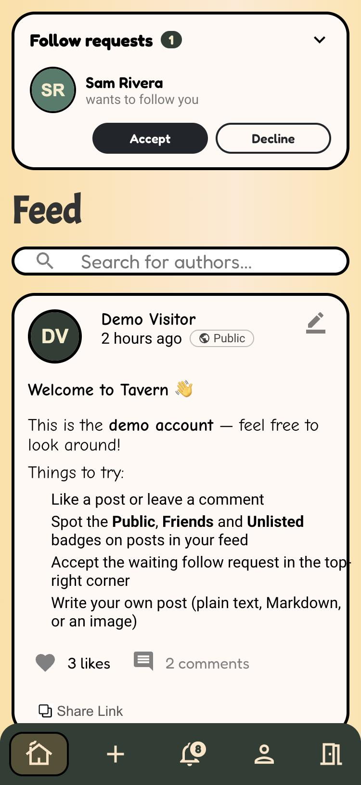

# Tavern

[](https://github.com/rithwikkb/Tavern/actions/workflows/ci.yml)
[](https://github.com/rithwikkb/Tavern/actions/workflows/codeql.yml)

**Live demo: [tavern-weyv.onrender.com](https://tavern-weyv.onrender.com)**: click **Try the demo account** on the login page.

A social networking web app where authors can post (plain text, Markdown, or images), follow each other, become friends, and comment on and like posts. Built with Django REST Framework and React.

Originally built as a team project for CMPUT 404 at the University of Alberta.

## Features

- Sign up, log in, and edit your profile (display name, GitHub link, profile picture)
- Create, edit, and delete posts with public, unlisted, or friends-only visibility
- One timeline with infinite scroll on the home feed and profiles, with a visibility badge on each post
- Follow requests, followers, and friends (mutual follows)
- Comments and likes on posts and comments; delete your own comments and any comment on your posts
- Notifications for likes, comments, and follows, with an unread badge
- Pull your public GitHub activity into your feed
- Phone-friendly layout
- Django admin panel for managing users and content
- Interactive API docs at [`/swagger/`](https://tavern-weyv.onrender.com/swagger/)

## Try it

Open the [live site](https://tavern-weyv.onrender.com) and use **Try the demo account** on the login page (username `demo`, password `TavernDemo2026`).
The demo account is friends with a few sample people, has a follow request and unread notifications
waiting, and its feed includes public, friends-only and unlisted posts with comments and likes. Its
profile can't be edited since everyone shares it; sign up to get your own account. Anything a visitor changes as
the demo account is undone automatically the next time someone logs in as the demo (at most every
10 minutes), so everyone starts from the same clean demo.

## Screenshots

| Home feed | Profile |
|---|---|
|  |  |

| Login with one-click demo | On a phone |
|---|---|
|  |  |

## Tech stack

- **Backend:** Django 5.2 (LTS), Django REST Framework, Simple JWT, WhiteNoise, Gunicorn
- **Frontend:** React 18, React Router 7, Material UI
- **Database:** PostgreSQL in production, SQLite locally

## Running locally

```bash
python3 -m venv .venv
source .venv/bin/activate
pip install -r requirements.txt

cd frontend
npm install
npm run build
cd ..

cd mistyrose
export DJANGO_DEBUG=True
python manage.py migrate
python manage.py createsuperuser
python manage.py seed_demo --site-url http://127.0.0.1:8000   # optional demo account + sample posts
python manage.py runserver
```

Then open http://127.0.0.1:8000. The admin panel is at `/admin/`.

Run the backend tests with `python manage.py test` from `mistyrose/`.

## Security and CI

Every pull request runs these checks in GitHub Actions, and `main` only accepts pull requests that pass all of them:

- **Tests:** the backend test suite (160+ tests), a check for missing migrations, and Django's production security checklist (`manage.py check --deploy`)
- **Frontend:** a production build that fails on any lint warning
- **Dependencies:** `pip-audit` and `npm audit` (packages that ship to the browser) for known vulnerabilities, and Dependabot opens weekly update PRs
- **Code scanning:** CodeQL for Python and JavaScript, and Bandit for Python
- **Secrets:** gitleaks scans the full git history, and GitHub secret scanning with push protection blocks pushes that contain secrets

The pipeline itself is locked down: workflows get read-only access, every third-party action is pinned to an exact commit, and the gitleaks download is checked against its published checksum.

In the app:

- JWT authentication with rotating refresh tokens, revoked on logout
- Every write checks that you're acting as yourself, and friends-only or deleted posts (and their comments and likes) never reach people who can't see them
- Markdown posts are sanitized with DOMPurify, and profile links only accept http(s) URLs
- Rate limiting on login, signup and image uploads
- HTTPS only: HTTP is redirected, HSTS is set, cookies are `Secure` (login cookies are also `SameSite=Strict`), and CSRF protection is on
- Unexpected errors are logged on the server, and clients only see a generic message
- Production won't start without a real `SECRET_KEY`, and debug mode is off unless explicitly enabled

Planned next:

- Store the JWTs in `HttpOnly` cookies, so a script injected through an XSS bug couldn't read them
- Add a Content Security Policy
- Keep rate-limit counts in a shared Redis cache (they're currently per server worker)

## Deploying

The live site runs on Render's free plan with a Neon Postgres database, and Render deploys `main` automatically once its CI checks pass. Render puts free services to sleep after about 15 minutes without traffic, so an [UptimeRobot](https://uptimerobot.com) monitor checks the `/healthz/` endpoint every 5 minutes, which keeps the site awake and sends an email if it goes down. `/healthz/` doesn't touch the database, so the checks don't keep the free Postgres database awake. The repo includes a `render.yaml` blueprint and a `build.sh` script. See `.env.example` for every environment variable the app reads. At minimum, production needs `DJANGO_SECRET_KEY` and a `DATABASE_URL` pointing at a hosted Postgres database.

## Team

Syjer Asuncion, Rithwik Korukonda Bhattar, Franco Bonilla, Xiangxu Meng, Kelly Shih, Sapandeep Singh

## License

MIT
